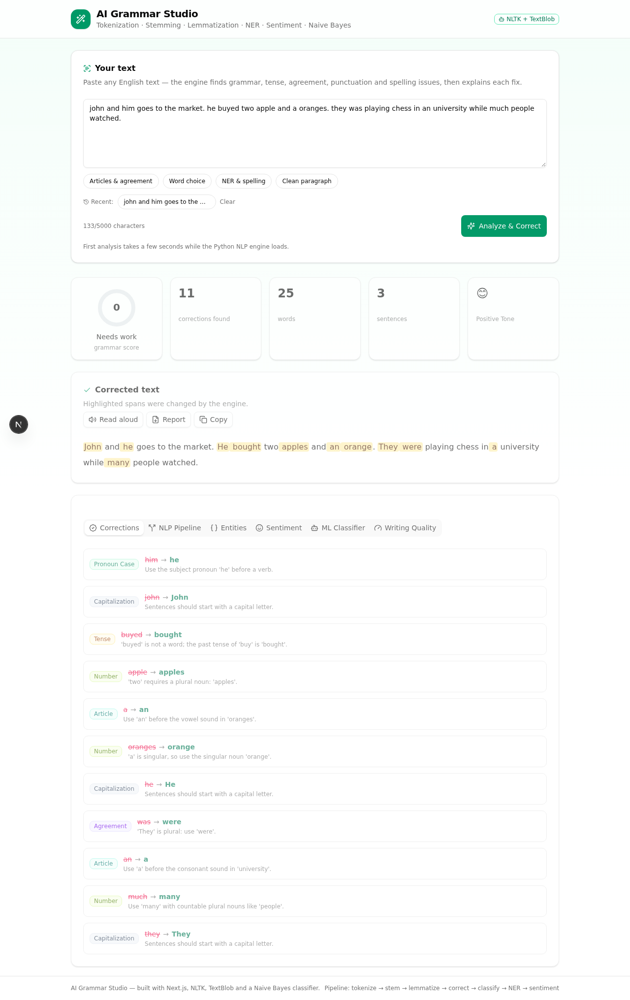
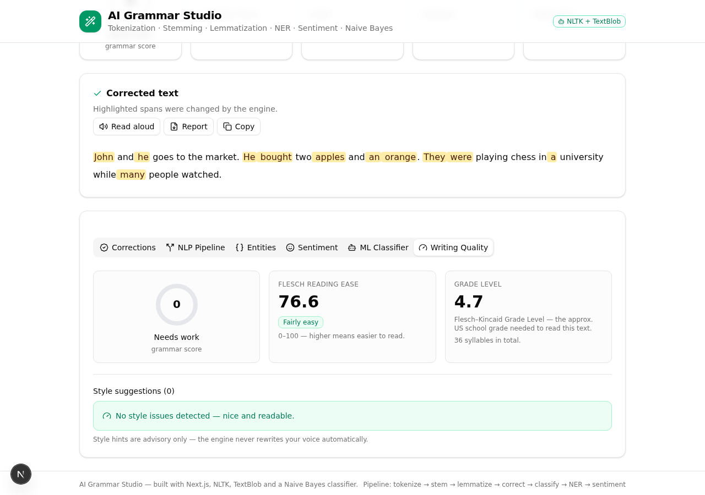
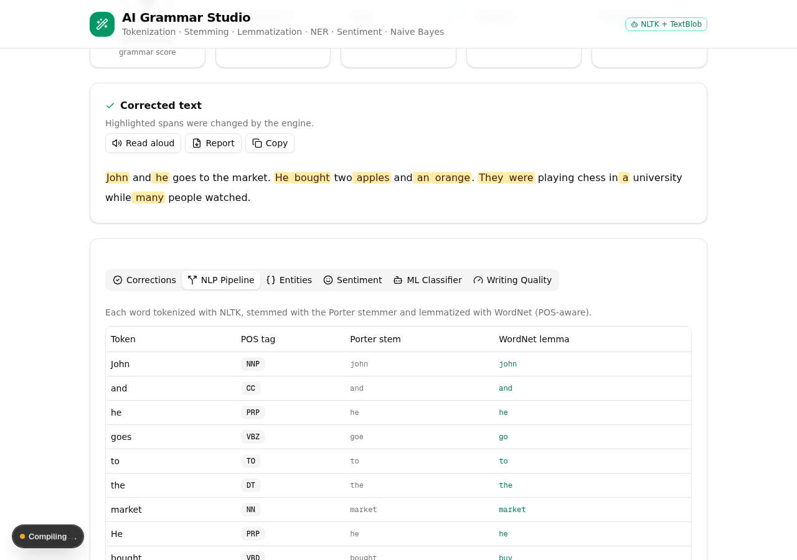

# AI Grammar Studio 🪄

An AI-powered grammar correction web app built with **Next.js + TypeScript** on the
frontend and a **pure Python NLP engine** (NLTK + TextBlob) on the backend — designed
as a learning project that *shows its work*: every classical NLP technique is
implemented explicitly and exposed in the UI.

## ✨ Features

### Core NLP pipeline (all implemented in `pyengine/`)
| Technique | Implementation | Where to see it |
|---|---|---|
| **Tokenization** | NLTK Punkt (sentences) + Treebank (words) + custom detokenizer | *NLP Pipeline* tab |
| **Stemming** | Porter Stemmer | *NLP Pipeline* tab |
| **Lemmatization** | WordNet Lemmatizer, POS-aware | *NLP Pipeline* tab |
| **NER** | `ne_chunk` (PERSON, GPE, ORGANIZATION, …) | *Entities* tab |
| **Sentiment analysis** | VADER (pos/neu/neg + compound) | *Sentiment* tab |
| **ML classification** | Multinomial Naive Bayes trained on Brown corpus + programmatic corruption (~99% hold-out accuracy) | *ML Classifier* tab |

### Grammar correction (rule suite, 12+ categories)
Subject–verb agreement · irregular past tenses · a/an article agreement ·
number–noun agreement · confusion pairs (its/it's, your/you're, then/than,
should of) · preposition fixes · missing contractions · pronoun case ·
capitalization · repeated words · punctuation · sentence-fragment detection ·
TextBlob spell-check (dictionary-gated so proper nouns are never mangled).

### Writing-quality analytics (new)
- **Grammar score 0–100** — error-density based, shown as an SVG ring
- **Readability** — Flesch Reading Ease + Flesch–Kincaid Grade Level with a
  syllable estimator
- **Style suggestions** — passive voice (POS-pattern based), long sentences,
  wordy phrases ("in order to" → "to"), adverb overuse, repeated sentence
  starts. Advisory only — the engine never rewrites your voice automatically.

### App niceties
Amber-highlighted corrections with per-fix explanations · sample texts ·
analysis history (localStorage) · read-aloud (SpeechSynthesis) ·
downloadable full analysis report (.txt) · fully responsive.

## 📸 Screenshots

**Full analysis** — 11 corrections found with per-fix explanations and amber highlights:



**Writing Quality tab** — grammar score ring, Flesch readability, style suggestions:



**NLP Pipeline tab** — tokenization / stemming / lemmatization side by side:



## 🏗 Architecture

```
Browser ──POST /api/analyze──▶ Next.js API route
                                 │  spawns python3 engine.py (stdin/stdout JSON)
                                 ▼
                         Python NLP engine
                         ├─ nlp_utils.py      tokenize / stem / lemma / NER / VADER
                         ├─ grammar_rules.py  12+ correction rules + pipeline order
                         ├─ text_quality.py   grammar score / readability / style
                         ├─ classifier.py     Naive Bayes (Brown-corpus trained)
                         └─ engine.py         orchestrator → JSON response
```

Stateless by design: every request spawns the engine, so there is no server
session to manage. The trained model ships in `pyengine/model/nb_model.pkl`
(retrain any time with `python3 train_run.py`).

## 🚀 Getting started

### Prerequisites
- Node.js 18+ (or Bun) — frontend
- Python 3.10+ — NLP engine

### 1. Frontend
```bash
npm install        # or: bun install
npm run dev        # http://localhost:3000
```

### 2. Python engine
```bash
cd pyengine
pip install -r requirements.txt
python3 -c "from nlp_utils import ensure_nltk_data; ensure_nltk_data()"
# optional — retrain the classifier (a trained model is already included):
python3 train_run.py
```

The NLTK data (~30 MB after download) is fetched automatically on first run
into `pyengine/nltk_data/` (see `ensure_nltk_data()`); it is git-ignored.

### 3. Tests
```bash
cd pyengine
pip install pytest
python3 -m pytest test_all.py -v        # 88 tests
python3 edge_sweep.py                   # 22 adversarial edge cases
```

## 📁 Project layout

```
├── src/
│   ├── app/
│   │   ├── page.tsx              # single-page UI (tabs, highlights, score ring)
│   │   ├── layout.tsx
│   │   └── api/analyze/route.ts  # spawns the Python engine, TS types of the contract
│   └── components/ui/            # shadcn/ui components
├── pyengine/
│   ├── engine.py                 # orchestrator (JSON in → JSON out)
│   ├── nlp_utils.py              # the 5 core NLP techniques
│   ├── grammar_rules.py          # rule suite + conjugation helpers
│   ├── text_quality.py           # score / readability / style suggestions
│   ├── classifier.py             # Naive Bayes train + predict
│   ├── train_run.py              # retrains model/nb_model.pkl
│   ├── edge_sweep.py             # 22 adversarial edge cases
│   ├── test_all.py               # pytest suite (88 tests)
│   └── model/nb_model.pkl        # trained classifier (included)
├── requirements.txt              # Python deps
└── package.json                  # Node deps
```

## 🔧 API contract

`POST /api/analyze` with `{ "text": "..." }` (≤ 5000 chars) returns:

```jsonc
{
  "correctedText": "...",
  "corrections":  [{ "rule", "ruleLabel", "original", "suggestion", "message", ... }],
  "highlights":   [{ "start", "end", "rule", "suggestion" }],   // char offsets in correctedText
  "pipeline":     { "tokens": [{ "token", "pos", "stem", "lemma" }] },
  "entities":     [{ "text", "type" }],
  "sentiment":    { "positive", "neutral", "negative", "compound", "label" },
  "stats":        { "wordCount", "sentenceCount", "avgSentenceLength", "lexicalDiversity" },
  "classifier":   { "label", "confidence", "accuracy", "trainSize", "testSize" },
  "quality":      { "score", "label" },
  "readability":  { "fleschReadingEase", "fleschKincaidGrade", "label", "syllables" },
  "style":        [{ "type", "message", "sentence", "match" }]
}
```

## 🧠 Notes for learners

- `grammar_rules.py` documents **why rule order matters** (copula rules must
  run before general agreement rules, or "it are" becomes "it ares").
- `test_all.py` doubles as executable documentation — each test class maps to
  one technique or rule family.
- The classifier's features (POS ratios, length buckets, error-pattern flags)
  are a nice example of cheap, interpretable features beating a black box.

## 🧰 Troubleshooting

**`ModuleNotFoundError: No module named 'nltk'`**
The Python engine's deps are missing from the interpreter the app spawned.
Fix manually, or just restart — `npm run dev` / `npm start` auto-run
`scripts/setup-python.sh`, which installs the deps into whichever `python3`
it finds:

```bash
cd pyengine && python3 -m pip install -r requirements.txt
```

If the error persists, your server uses several Pythons — install into the
one on your `PATH`: `python3 -m pip show nltk` should report a Location.

The UI also translates this failure into the exact command to run.

## Tech stack

Next.js 16 · React 19 · TypeScript · Tailwind CSS 4 · shadcn/ui · Framer Motion ·
Python · NLTK · TextBlob · pytest
